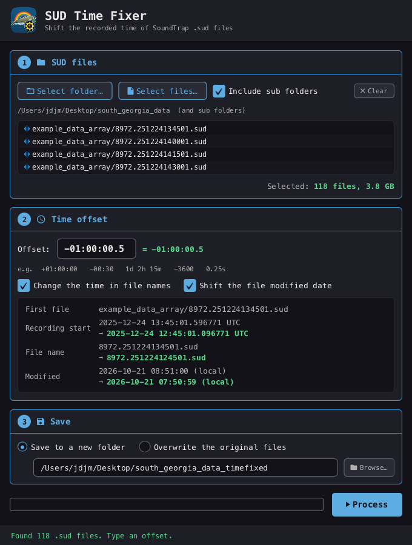

# SUD Time Fixer

A small desktop app that shifts the recorded time of SoundTrap `.sud` files by a fixed offset –
for when a recorder's clock was set wrong.



1. **SUD files** – pick a folder (optionally including sub folders) or several `.sud` files.
2. **Time offset** – type the time to add; negative values subtract. Accepted forms:
   `+01:00:00`, `-00:30`, `1d 02:00:00`, `1d 2h 15m 4.5s`, `-90m`, `250ms`, or plain seconds (`-3600`).
   The preview shows what the first file's recording start, name and modified date become.
3. **Save** – write corrected copies to a new folder (sub folders are recreated), or overwrite the originals.

Then press **Process**; the progress bar beside it tracks the run.

## What gets changed

| Where | Change |
|---|---|
| Every chunk header (XML metadata and audio) | `TimeS` / `TimeOffsetUs` shifted to the microsecond; header CRC recomputed |
| XML metadata text | ISO date-times such as `2025-01-25T00:00:04` shifted; data CRC recomputed |
| File name | SoundTrap `serial.yyMMddHHmmss.sud`, `yyyyMMdd_HHmmss` and `yyyyMMddHHmmss` times shifted (optional) |
| File modified date | shifted by the same offset (optional) |

Left as they are: the audio data itself, the 30 byte file header (it records the offload host's
time, not the recording time), the firmware build date in `<BINFILE>`, and any bytes after the last
complete chunk. Companion `.sudx` / `.log.xml` files are not modified.

Files are written to a temporary file first, so an error or cancel never leaves a half written `.sud`.
In place, renamed files only take their new names once every file is done, so shifting a sequence of
recordings by a multiple of their length does not overwrite its neighbours. A file is never written
over an unrelated existing file.

## Build

Requires JDK 17+ and Maven.

```bash
mvn javafx:run                          # run from source
mvn test                                # unit tests
mvn -Pinstaller-mac clean verify        # macOS  -> target/installer/*.dmg
mvn -Pinstaller-windows clean verify    # Windows -> target\installer\*.msi (needs WiX 3)
```

The **Installers** GitHub workflow builds the Windows `.msi` and macOS `.dmg` (Apple silicon and
Intel). To release, bump `<version>` in `pom.xml` and push to `main`: the workflow builds the
installers and publishes them as GitHub release `v<version>`. Pushing a version tag, or running the
workflow by hand on `main` (Actions → Installers → Run workflow), does the same.

The icon is the WhalePi Host artwork with a cog/clock badge; regenerate it with
`java build/icon/MakeIcon.java` (the `.icns` step needs macOS).
